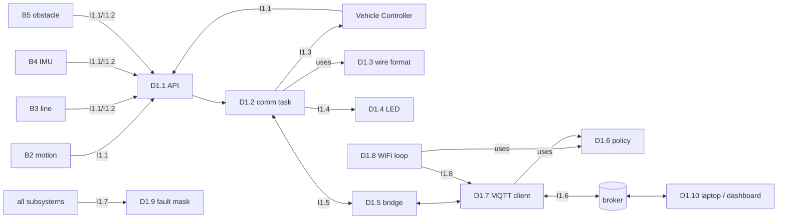
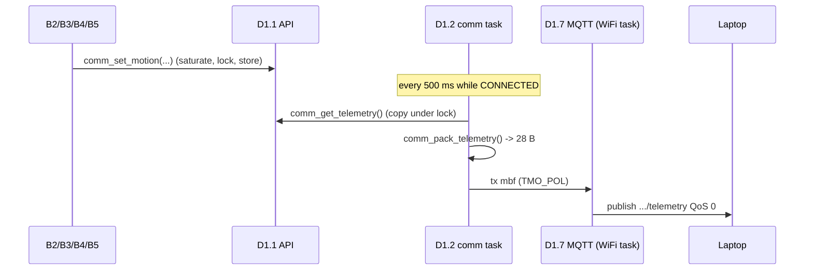
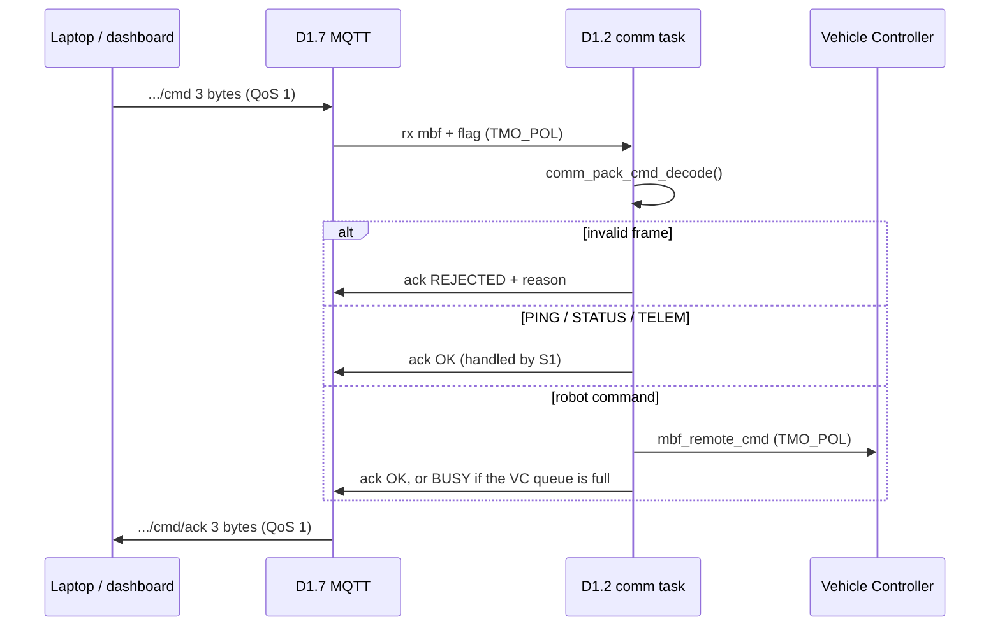
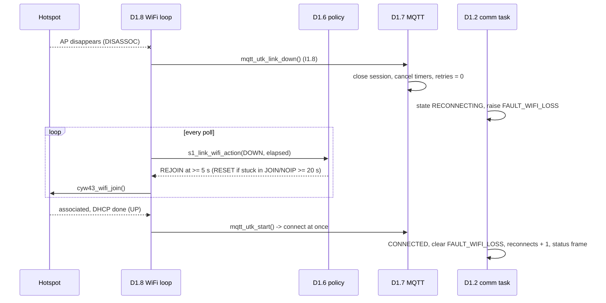
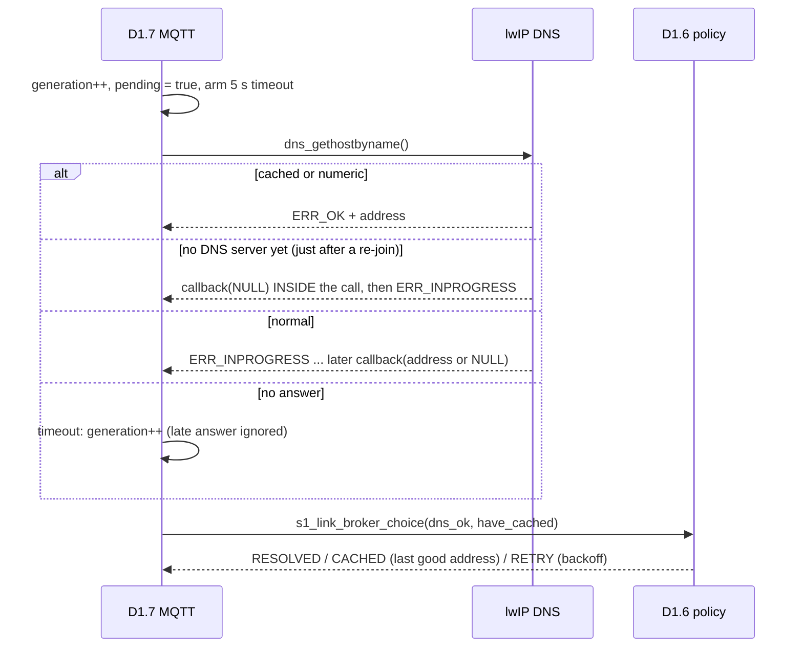
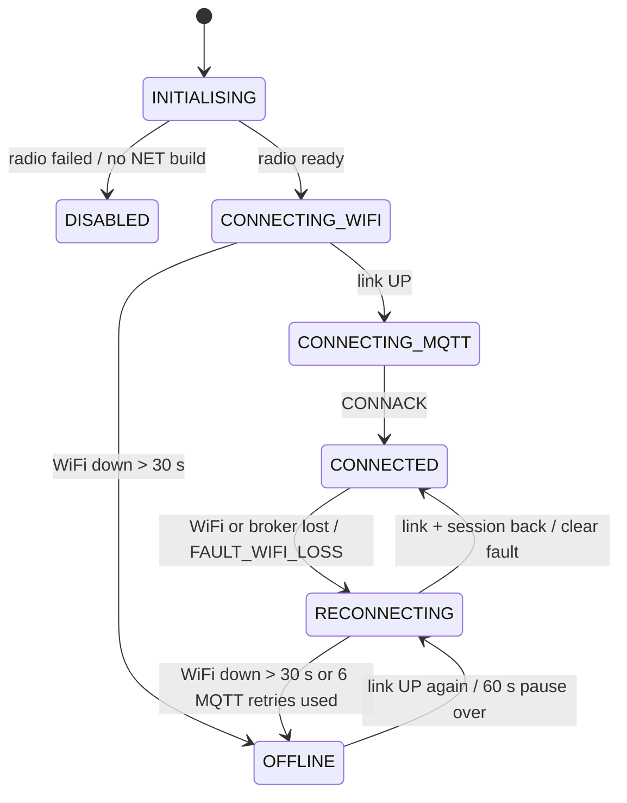

# Subsystem 1 (WiFi, Command & Telemetry): high-level design

Lecture 5 format: every box (D) and arrow (I) has an ID; one sequence diagram
per scenario, including the error cases; one unified statechart. Requirements
and the trace to code and tests are in `REQUIREMENTS_TRACE.md`.

## 1. Architecture: boxes and arrows

| ID | Design element | File(s) | Runs on |
|---|---|---|---|
| D1.1 | Public API: telemetry snapshot, event queueing, link status | `comm.c` / `comm.h` | caller's task |
| D1.2 | Comm task: link statechart, command validation, framing, heartbeat | `s1_comm.c` | task, priority 13 |
| D1.3 | Wire format: bit packing, command decoding | `comm_pack.c` | pure functions |
| D1.4 | Status LED | `s1_led.c` | task 12 + 250 ms cyclic handler |
| D1.5 | Bridge to the kernel network task | `comm_bridge.c` / `.h` | both sides, TMO_POL only |
| D1.6 | Reconnect policy: WiFi re-join, MQTT backoff, DNS fallback | `s1_link.c` | pure functions |
| D1.7 | MQTT client: connect, publish, subscribe, DNS lookup | `lib/liblwip/.../mqtt_utk.c` | kernel WiFi task |
| D1.8 | WiFi driver loop: poll, join, re-join | `lib/libwifi/.../cyw43_utk.c` | kernel WiFi task, 2 ms |
| D1.9 | Shared fault mask | `app_program/fault.c` | any task or ISR |
| D1.10 | Laptop tools: monitor, command sender, dashboard | `tools/` | laptop |

| ID | Interface | From -> to | Contract |
|---|---|---|---|
| I1.1 | IF-S1-TLM `comm_set_xxx()` | B2/B3/B4/B5/VC -> D1.1 | non-blocking, saturates, <= 5 ms mutex wait |
| I1.2 | IF-S1-EVT `comm_report_xxx()` | any task -> D1.1 -> D1.2 | returns E_OK / E_PAR / E_TMOUT, never waits |
| I1.3 | IF-S1-CMD `mbf_remote_cmd` | D1.2 -> Vehicle Controller | 4-byte validated command, queue of 8 |
| I1.4 | link status `comm_get_state()` | D1.2 -> anyone | 7 states |
| I1.5 | tx / rx message buffers | D1.2 <-> D1.7 via D1.5 | TMO_POL both ways |
| I1.6 | MQTT topics `inf2004/g25/car/...` | D1.7 <-> broker <-> D1.10 | binary frames, MQTT.md section 2 |
| I1.7 | fault mask `fault_raise/clear/get` | every subsystem <-> D1.9 | event flag, ISR-safe |
| I1.8 | link-down notice `mqtt_utk_link_down()` | D1.8 -> D1.7 | called once when the link leaves UP |

## 2. Sequence diagrams

### SD-1 Telemetry (FR-B1-3). Pre: connected. Post: one 28-byte frame at the laptop.

### SD-2 Remote command (FR-B1-5, NFR-B1-5). Post: command in the VC queue and an ack at the laptop.

### SD-3 WiFi lost and back (FR-B1-7, NFR-B1-1, NFR-B1-6). Edge case.

The robot keeps driving throughout: no S1 call waits on the network.

### SD-4 Broker host name lookup (NFR-B1-7). Only with `MQTT_BROKER_HOST`.

## 3. Unified statechart (comm task, `comm_link_state_t`)

The MQTT client (D1.7) has its own sub-states: IDLE, RESOLVING,
CONNECTING, CONNECTED, BACKOFF (1, 2, 4, 8, 16, 16 s), OFFLINE (60 s).

## 4. Data and resources

Message sizes and RAM: `DATA_REPRESENTATION.md`. After the BARR-C rewrite the
B1 application state is unchanged (about 190 bytes); the DNS fallback adds 10
bytes in `mqtt_utk.c`, and one lwIP timeout slot.
